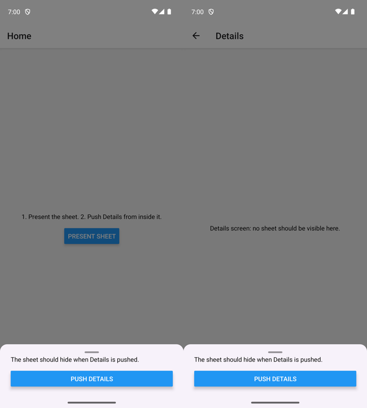
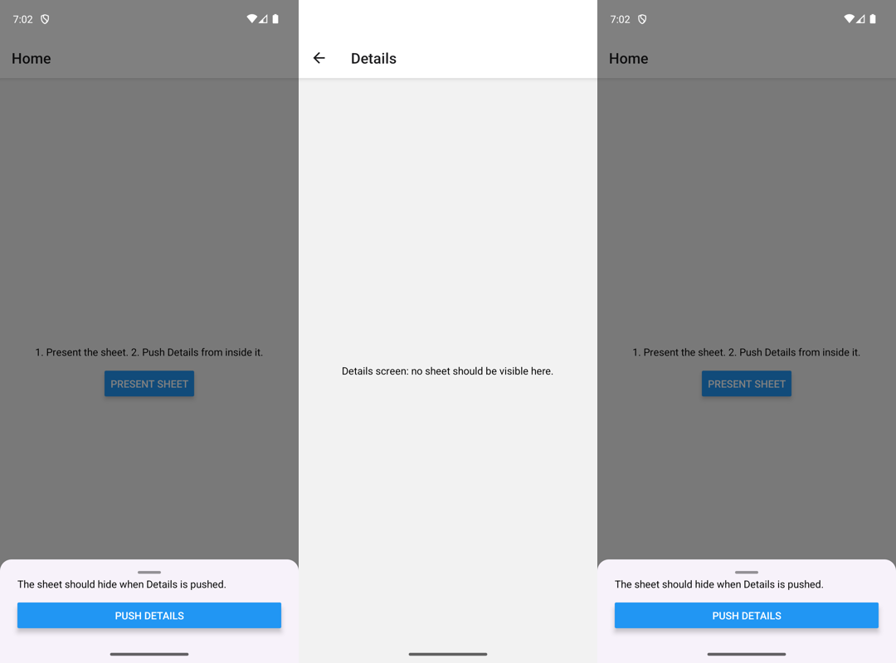

# TrueSheet R8 reproduction

Minimal reproduction for [lodev09/react-native-true-sheet#883](https://github.com/lodev09/react-native-true-sheet/issues/883).

On Android, a presented sheet is not hidden when its presenter screen disappears if the release build is minified with R8.

## Versions

- Expo SDK 57 (`expo@57.0.26`), React Native 0.86.3, New Architecture
- `@lodev09/react-native-true-sheet@4.0.0-beta.21`
- `expo-router@57.0.24`, `react-native-screens@4.26.x`
- R8 enabled with `expo-build-properties` → `android.enableMinifyInReleaseBuilds: true` (the default in the Expo SDK 58 template)

## Steps

```sh
npm install
npx expo run:android --variant release
```

1. Tap **Present sheet**.
2. In the sheet, tap **Push Details**.

**Expected:** the sheet hides while Details is shown, and appears again after going back. This is what a debug build does (`npx expo run:android`).

**Actual (minified release):** the sheet stays on top of the Details screen.

Setting `enableMinifyInReleaseBuilds` to `false` in `app.json` and rebuilding the release variant restores the expected behavior.

Minified release (sheet stays above Details):



Same release build without minification (sheet hides on Details, returns on Home):



Recorded on an Android 14 emulator (Pixel 7, arm64).

## Cause

`RNScreensEventObserver` compares `view.javaClass.name` with `"com.swmansion.rnscreens.Screen"`. R8 renames that class, so the presenter screen is never captured and `topWillDisappear` is ignored.
